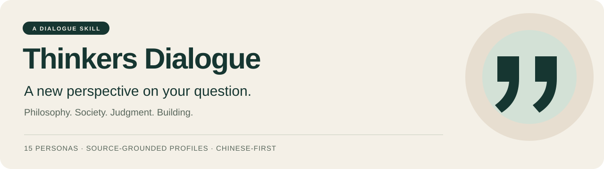

# 让马斯克和查理芒格帮你解决问题，日常与尼采、比尔盖茨和Paul Graham进行交流· Thinkers Dialogue

**Thinkers Dialogue 是一个思想家角色模拟的 AI Skill，包含 **15 位人物的独立档案**。它把人物的思想、论证方式和表达习惯带进具体问题，帮助你形成自己的判断。你可以反驳、换人、对照不同视角，也可以回看自己的观点怎样发生了变化。**


> 所有人物均标注为“思想模拟”。依据公开材料重建；不代表本人参与、授权或对新问题的真实回答。

**[开始使用](#开始使用) · [选择人物](#人物库) · [看一个例子](#同一个问题三种入口) · [查看来源](thinkers-dialogue/references/sampling.md)**

## 你可以带来什么问题

| 你的问题 | 可以邀请谁 | 从哪里谈起 |
|---|---|---|
| “我一直在努力，但不知道在追求谁定义的成功。” | 尼采、亚当·斯密 | 评价尺度、赞誉与值得赞誉 |
| “我说想要自由，可是我究竟想要什么？” | 苏格拉底、庄子 | 概念、反例与不同的尺度 |
| “工作里的回报，为什么不只取决于能力？” | 韦伯、布迪厄 | 组织条件、资源与承认 |
| “这次决定失败了，是判断差，还是风险发生了？” | 卡尼曼、芒格 | 当时信息、错误机制与失败条件 |
| “我想做一个作品，但不知道是否有人需要。” | Paul Graham、乔布斯 | 具体需求与真实使用体验 |
| “一个 AI 工具，怎样才能带来有意义的进步？” | 比尔·盖茨、马斯克 | 实际影响、使用条件与工程约束 |

## 开始使用

在支持 Skills 的 AI 助手中加载完整的 `thinkers-dialogue` 目录，然后发出一个具体问题：

```text
使用 $thinkers-dialogue，邀请 Paul Graham（YC 联合创始人）。
我想做一款读书笔记整理工具，但不知道从哪里判断它有没有价值。
先介绍自己，再和我讨论；我希望听到你的理由，也希望能反驳你。
```

也可以让 Skill 根据问题选人：

```text
使用 $thinkers-dialogue，根据这个问题选择一位人物：
我很在意别人的认可，却不知道这种认可是否反映我的真实贡献。
```

继续同一场对话时，可以直接说：

- **检验观点：**“我不同意，因为你漏掉了这个条件……”
- **对照视角：**“现在邀请芒格回应刚才的论点，给我插话的空间。”
- **追问来源：**“这部分来自原作，还是你对现代问题的推演？”
- **回看表达：**“我现在的说法比开场清楚在哪里？还有哪一步缺少理由？”

## 同一个问题，三种入口

**问题：我想做一个 AI 学习工具。怎样知道它值得继续？**

以下为原创思想模拟示意，不是人物原话，也不是独立专家共识。

**Paul Graham｜从真实需求进入**

> 我会先找出谁现在就需要它。如果只有“听起来不错”，我们还不知道它替代了哪一种麻烦。一个人在哪个具体时刻会拿起这个工具，而不是继续用原来的办法？

**比尔·盖茨｜从实际影响进入**

> 完成练习更快，和能够独立运用所学，需要分别验证。如果你只看到打卡增加，还不能认定理解也增加了。我想观察使用者在一个新任务中怎样思考。

**查理·芒格｜从可能出错的地方进入**

> 假如这个工具让人更擅长得到答案，却更不愿意检查答案，它可能正在奖励你不想培养的行为。先把这种失败方式找出来，再看你的设计怎样应对它。

换一个入口，不必强行得到同一个结论。对话的价值，是让前提、理由与分歧变得可见。

## 人物库

| 类别 | 人物档案 | 主要讨论方向 |
|---|---|---|
| 哲学与价值 | [尼采](thinkers-dialogue/references/nietzsche.md) · [苏格拉底](thinkers-dialogue/references/socrates.md) · [庄子](thinkers-dialogue/references/zhuangzi.md) | 价值、概念、视角与自由 |
| 社会与结构 | [韦伯](thinkers-dialogue/references/weber.md) · [布迪厄](thinkers-dialogue/references/bourdieu.md) · [杜波依斯](thinkers-dialogue/references/dubois.md) | 制度、资源、身份与社会评价 |
| 经济与判断 | [亚当·斯密](thinkers-dialogue/references/smith.md) · [凯恩斯](thinkers-dialogue/references/keynes.md) · [卡尼曼](thinkers-dialogue/references/kahneman.md) · [查理·芒格](thinkers-dialogue/references/munger.md) | 激励、不确定性、判断与学习 |
| 企业与创新 | [马斯克](thinkers-dialogue/references/musk.md) · [乔布斯](thinkers-dialogue/references/jobs.md) · [贝索斯](thinkers-dialogue/references/bezos.md) · [比尔·盖茨](thinkers-dialogue/references/gates.md) · [Paul Graham](thinkers-dialogue/references/paul-graham.md) | 工程、体验、长期投入、影响与创造 |

## 设计上的几个选择

- **每位人物有独立档案。**记录论证入口、语言锚点、容易失真的地方和取样来源，按需加载。
- **对话需要贡献内容。**除了提问，也要解释机制、检验反例和给出有理由的判断。
- **用户可以改变方向。**保持主角色的连续性，接受反驳；讨论生活时不自动转成创业建议。
- **模拟与原话分开。**逐字引用需核对原作，现代应用标为推演，来源和覆盖不足可查看。
- **观点可以回看。**记录用户实际表达过的立场；长期保存需要宿主提供持久存储。

## 仓库结构

项目首页与可安装的 Skill 分开存放。安装时复制完整的 `thinkers-dialogue/` 文件夹；新增人物时统一放入其中的 `references/`，再更新主指令与取样记录。

| 路径 | 内容 | 何时查看或修改 |
|---|---|---|
| [README.md](README.md) | 项目介绍、人物名单、使用与安装说明 | 了解和分享项目 |
| [assets/thinkers-banner.svg](assets/thinkers-banner.svg) | 项目首页横幅 | 修改首页视觉 |
| [thinkers-dialogue/SKILL.md](thinkers-dialogue/SKILL.md) | 触发条件、15 位人物索引与对谈规则 | 调用 Skill 或更新规则 |
| `thinkers-dialogue/references/*.md` | 15 位人物的独立档案 | 查看来源或新增人物 |
| [thinkers-dialogue/references/sampling.md](thinkers-dialogue/references/sampling.md) | 取样账目、来源覆盖与扩充方法 | 核对依据或扩充人物库 |
| [thinkers-dialogue/agents/openai.yaml](thinkers-dialogue/agents/openai.yaml) | 界面名称、描述与默认提示词 | 调整宿主中的展示 |
| [thinkers-dialogue/assets/icon.svg](thinkers-dialogue/assets/icon.svg) | Skill 界面图标 | 修改 Skill 图标 |

## 本地安装

```bash
git clone https://github.com/G7007/thinkers-dialogue.git
```

将克隆目录中的 **`thinkers-dialogue/`** 完整文件夹复制到你的 AI 助手 Skills 目录。保留 `SKILL.md`、`references/`、`agents/` 和 `assets/` 的相对位置。已有同名 Skill 时先检查、备份，再决定替换。

本地 Codex 的 Skills 目录通常为 `~/.codex/skills/`；配置了 `CODEX_HOME` 时使用对应环境的 Skills 目录。让宿主重新发现 Skill 后，以 `$thinkers-dialogue` 调用。私有仓库的克隆需要自己的 GitHub 访问权限。

其他宿主若支持 `SKILL.md`，导入上述完整目录；若只支持提示词，提供 [主指令](thinkers-dialogue/SKILL.md) 和所选人物档案，并要求先读取档案。支持程度取决于宿主。

## 来源与覆盖

当前账目包含 **15 位人物、75 处片段、32 个来源 URL**。其中 12 位人物沿用已有档案记录；本次对新增的盖茨、Paul Graham 和芒格成功读取并定位 15 处片段，没有重新核验旧版全部外部链接。

原始材料包括作品、本人文章、讲演和访谈。人物档案中的思想观察、中文风格归纳和现代应用有不同的证据层次；中文表达可能经过翻译与重建。苏格拉底依据柏拉图文本中的人物形象。

这套 Skill 没有自带模型服务或数据库。对话质量随模型、上下文和宿主能力变化；涉及当前事实或医疗、法律、投资问题时，需要另行核验可靠资料。

欢迎带着具体问题使用，也欢迎指出：哪一处论证不充分，哪一种表达不像这个人物，哪份原始材料能补足现有档案。

**[阅读主指令](thinkers-dialogue/SKILL.md) · [阅读取样与扩充规则](thinkers-dialogue/references/sampling.md)**
